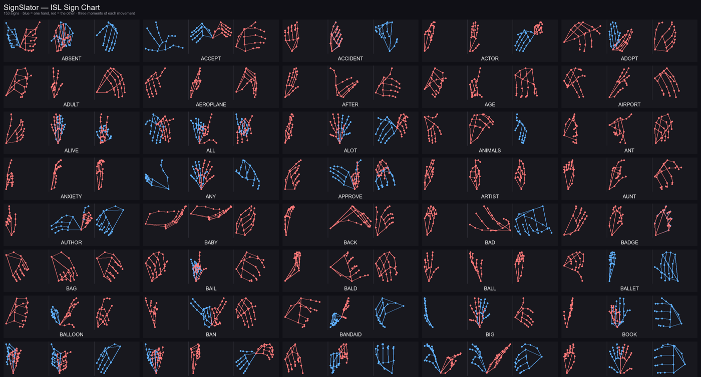

# SignSlator

**Indian Sign Language (ISL) ↔ Speech — both directions, fully offline, no recording required.**

A bidirectional translator that reads hand gestures from a webcam and speaks them,
and does the reverse: hear speech and watch the sign performed.

Everything is free and open-source. Sign data comes from a public research dataset
and is downloaded at runtime — you never have to film yourself.

---

## How it works


| Direction | Pipeline |
|---|---|
| **Sign → Speech** | Webcam → MediaPipe Holistic → hand landmarks (21 × 2) → DTW classifier → pyttsx3 |
| **Speech → Sign** | Microphone → Whisper ASR → text → sign lookup → landmark animation |

**Why DTW and not a neural net?** The classifier compares the *shape of your hand
movement over time* against stored templates using Dynamic Time Warping. It needs
only a handful of examples per sign, runs in milliseconds on a CPU, and — unlike a
black-box model — its confidence scores are interpretable and auto-calibrated.

---

## Quick start

```bash
# 1. Install everything (dependencies + MediaPipe model)
python setup.py

# 2. Download starter signs — no camera, no recording
python run.py isl-download

# 3a. Sign → speech (camera)
python run.py recognize

# 3b. Speech → sign (microphone)
python run.py speech-to-sign
```

Requires Python 3.9+, a webcam, and internet for the first setup.
Windows / macOS / Linux.

---

## Accuracy

Measured by **leave-one-out cross-validation** — every sample is held out and
matched against the rest, so the number reflects real generalization, not
self-matching.

```
153 signs · 605 templates · held-out sessions
FULL-DATASET ACCURACY:  572/605 = 94.5%
```

| | |
|---|---|
| Mean DTW distance — correct match | 0.366 |
| Mean DTW distance — wrong match | 0.524 |
| Signs at 100% | 137 / 153 |

**Weakest signs** (honest reporting — these are the ones that get confused):

| Sign | Accuracy | Typical confusion |
|---|---|---|
| BANDAID | 0/3 | FAT, EAST, I |
| FIRE | 0/4 | — |
| ALOT | 2/4 | BIG |
| GLOVES | 2/4 | GLOVE (singular — near-miss) |
| BOOK | 2/3 | SCHOOL |
| WHY | 2/3 | — |

**Important caveat:** 94.5% is measured *within one signer* — the ISL500
dataset's performer. Accuracy on **your** hands is lower, because hand size,
distance, and signing style differ. Measure it yourself:

```bash
python run.py self-test          # records your samples, prints 3 accuracy numbers
```

Full per-sign breakdown and confusion list: [`docs/accuracy_report.txt`](docs/accuracy_report.txt)

---

## The sign chart

Every downloaded sign is rendered as a hand-skeleton animation, so you can see
exactly what movement each word requires.



```bash
python run.py chart                 # regenerate: PNG poster + browseable HTML
python run.py guide --video HELLO   # download the real signer's reference video
```

---

## All commands

| Command | What it does |
|---|---|
| `python run.py isl-download` | Fetch ISL signs from the ISL500 dataset (no recording) |
| `python run.py isl-evaluate` | Leave-one-out accuracy on a sign set |
| `python run.py full-eval` | Accuracy across **all** downloaded signs |
| `python run.py self-test` | Measure accuracy on **your** hands |
| `python run.py recognize` | Live sign → speech |
| `python run.py speech-to-sign` | Live speech → sign animation |
| `python run.py train HELLO` | Record your own samples for a sign |
| `python run.py chart` | Generate the visual sign chart |
| `python run.py guide` | Render individual sign animations / reference videos |
| `python run.py list` | List downloaded signs |
| `python run.py camera` | Camera + landmark preview |
| `python run.py demo` | Quick component check |

---

## Vocabulary

**153 ISL signs** included in a typical setup, out of **500** available.
Add any of them:

```bash
python run.py isl-download --words Baby Bank Ball Teacher Friend
python run.py isl-download --sessions 8      # more templates → better accuracy
python run.py list
```

Note: ISL500 has no "Sorry", "Thank", "Stop", or "When" — the closest signs are
**Regret**, **Thankyou**, **Stay**, and **Which**.

---

## How the accuracy works

Three design decisions matter, and each was measured rather than assumed:

**1. Scale normalization.** MediaPipe's coordinates depend on hand distance and
hand size — the main reason one person's templates fail on another. Each hand is
centered on the wrist and divided by its palm size, leaving pure hand *shape*.

```
raw coordinates:      37/40 = 92.5%
scale-normalized:     39/40 = 97.5%    (+5 points)
```

**2. Auto-calibrated thresholds.** DTW distances are scale-dependent, so a fixed
acceptance threshold is meaningless. The system learns the threshold from the
template set itself — the 90th percentile of same-sign distances versus the 10th
percentile of different-sign distances.

**3. Margin over the runner-up.** A low absolute distance is not evidence when two
signs look alike. A match is only accepted when it also beats the second-best sign
by a margin ratio.

---

## Project structure

```
sign-language-workspace/
├── run.py                    # entry point — every command
├── setup.py                  # one-command installer / verifier
├── package.py                # builds a portable zip
├── requirements.txt
├── docs/
│   ├── architecture.png      # pipeline diagram
│   └── sign_chart_preview.png
└── signslator/
    ├── sign_to_speech.py     # sign → speech: train, recognize, calibration
    ├── speech_to_sign.py     # speech → sign: ASR + animation replay
    ├── isl500_loader.py      # dataset downloader / converter
    ├── self_test.py          # accuracy on your own hands
    ├── sign_guide.py         # per-sign animations
    ├── sign_chart.py         # poster / HTML chart
    ├── full_eval.py          # full-dataset accuracy
    └── models/               # MediaPipe model (downloaded by setup.py)
```

Sign templates, cached dataset files, and generated guides are **not** committed —
they are regenerated by the commands above, which keeps the repository small.

---

## Tech stack

| Component | Library | License |
|---|---|---|
| Hand / body landmarks | MediaPipe Holistic | Apache 2.0 (Google) |
| Sequence classification | DTW (custom, NumPy) | — |
| Speech recognition | OpenAI Whisper (base) | MIT |
| Speech synthesis | pyttsx3 | MPL-2.0 |
| Capture / rendering | OpenCV, Pillow | Apache 2.0 / HPND |
| Sign data | ISL500 (HuggingFace) | research & academic |

---

## Limitations — stated plainly

- **Isolated signs only.** Continuous signing (full sentences) is a research
  problem and is not attempted here.
- **Signer-dependent.** 94.5% is within one signer. Cross-signer accuracy is
  lower; recording your own samples closes the gap.
- **Recognition, not translation.** ISL has its own grammar; this maps signs to
  English words, not fluent ISL sentence structure.
- **Animation replays recorded landmarks** — a moving hand skeleton, not a
  polished avatar.
- **Whisper base** is good but not perfect; larger models are available.

## Future work

- Continuous signing with a sequence model (LSTM / transformer)
- Cross-signer normalization or signer-adaptive fine-tuning
- Facial-expression features for signs that depend on expression
- Web / mobile interface

---

## Running on another machine

```bash
python package.py          # → signslator-portable.zip

# target machine:
#   1. unzip anywhere
#   2. python setup.py
#   3. python run.py recognize
```

---

## License

MIT — see [LICENSE](LICENSE).

**Data notice:** this repository ships no sign-language data. Templates are
downloaded at runtime from the [ISL500 dataset](https://huggingface.co/datasets/ISL500/ISL-DATA),
which is licensed for **research and academic use**. Do not redistribute derived
templates commercially.
