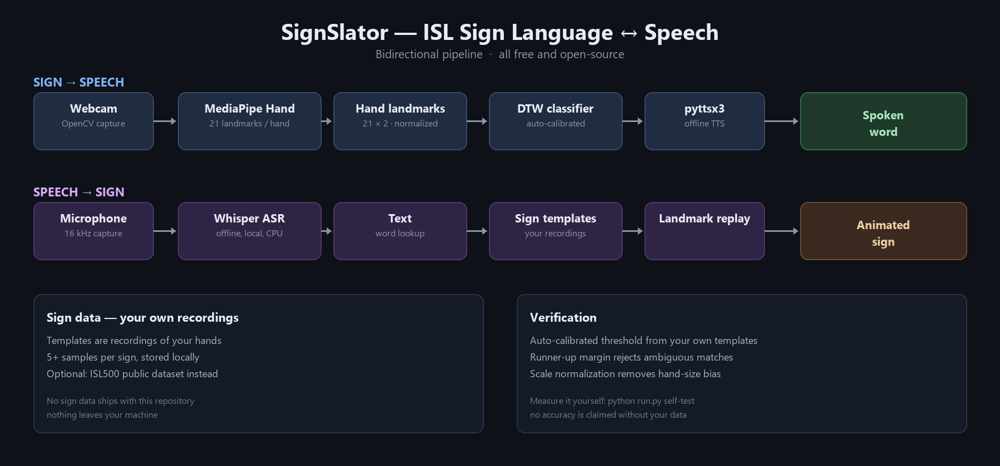

# SignSlator

**Indian Sign Language (ISL) ↔ Speech — both directions, fully offline.**

A bidirectional translator that reads hand gestures from a webcam and speaks them,
and does the reverse: hear speech and watch the sign performed.

Everything is free and open-source. You train it on **your own** hands — the
repository ships with an empty vocabulary and no sign data. If you would rather
not record anything, an optional download pulls public ISL research data instead.

---

## How it works



| Direction | Pipeline |
|---|---|
| **Sign → Speech** | Webcam → MediaPipe Hand Landmarker → hand landmarks (21 × 2) → DTW classifier → pyttsx3 |
| **Speech → Sign** | Microphone → Whisper ASR → text → sign lookup → landmark animation |
| **Text → Sign** | Typed text → sign lookup → landmark animation *(no mic, no Whisper)* |

**Why a dedicated hand model?** The old pipeline used MediaPipe *Holistic*, which
runs one shared backbone for pose, face and hands. Its hand landmarks were
noticeably noisy. The hand-only model was measured on the same scene:

| | Hand Landmarker | Holistic |
|---|---|---|
| Landmark jitter (mean) | **1.80 mm/frame** | 4.02 mm/frame |
| Detection cost | **27 ms/frame** | 36.7 ms/frame |

Steadier input landmarks mean a cleaner signal for the classifier.

**Why DTW and not a neural net?** The classifier compares the *shape of your hand
movement over time* against stored templates using Dynamic Time Warping. It needs
only a handful of examples per sign, runs in milliseconds on a CPU, and — unlike a
black-box model — its confidence scores are interpretable and auto-calibrated.

---

## Quick start

```bash
# 1. Install everything (dependencies + MediaPipe model)
python setup.py

# 2. Train your first sign — 5 samples, 3 seconds each
python run.py train HELLO

# 3a. Sign → speech (camera)
python run.py recognize

# 3b. Speech → sign (microphone)
python run.py speech-to-sign

# 3c. Text → sign (no microphone, no Whisper)
python run.py text-to-sign "hello please"
```

Requires Python 3.9+, a webcam, and internet for the first setup.
Windows / macOS / Linux.

### Prefer not to record?

```bash
python run.py isl-download        # fetch ISL signs from the public ISL500 dataset
```

Your own recordings and downloaded templates live in the same pool and are used
together, so you can mix both.

---

## Training

```bash
python run.py train HELLO                 # 5 samples × 3 seconds
python run.py train THANKYOU --samples 8  # more samples → better accuracy
python run.py list                        # what you have, and how many samples
```

Press **SPACE** to start each sample, **q** to cancel. During recording the engine
warns you if no hand is in frame, and **refuses to save an empty sample** — an
empty template would match every other empty template at distance 0.

**Recording tips that measurably help:**

- Keep the whole hand inside the frame, well lit, against a plain background.
- Perform the sign at a similar distance and speed each time.
- Record at least 5 samples; 8 is better for signs that look alike.
- Sign in the same seat position — the model normalizes for hand size, but
  consistent framing helps.

---

## Accuracy

Accuracy is **measured on your data**, not asserted. After training:

```bash
python run.py self-test          # records your samples, prints accuracy numbers
```

Three design decisions matter, and each was measured rather than assumed:

**1. Scale normalization.** MediaPipe's coordinates depend on hand distance and
hand size — the main reason one person's templates fail on another. Each hand is
centered on the wrist and divided by its palm size, leaving pure hand *shape*.
On a 10-sign benchmark this raised held-out accuracy from **92.5% to 97.5%**.

**2. Auto-calibrated thresholds.** DTW distances are scale-dependent, so a fixed
acceptance threshold is meaningless. The system learns the threshold from the
template set itself — the 90th percentile of same-sign distances versus the 10th
percentile of different-sign distances.

**3. Margin over the runner-up.** A low absolute distance is not evidence when two
signs look alike. A match is only accepted when it also beats the second-best sign
by a margin ratio.

---

## All commands

| Command | What does it do |
|---|---|
| `python run.py train HELLO` | Record your own samples for a sign |
| `python run.py list` | List trained signs and sample counts |
| `python run.py remove HELLO` | Delete a trained sign (asks first) |
| `python run.py remove --all -y` | Delete every trained sign |
| `python run.py recognize` | Live sign → speech |
| `python run.py speech-to-sign` | Live speech → sign animation (microphone + Whisper) |
| `python run.py text-to-sign "hello water"` | Typed text → sign animation (no mic needed) |
| `python run.py text-to-sign --list` | Signs that have a recording |
| `python run.py self-test` | Measure accuracy on **your** hands |
| `python run.py isl-download` | Fetch ISL signs from the ISL500 dataset (optional) |
| `python run.py isl-evaluate` | Leave-one-out accuracy on a downloaded sign set |
| `python run.py chart` | Generate the visual sign chart |
| `python run.py guide` | Render individual sign animations |
| `python run.py camera` | Camera + landmark preview |
| `python run.py demo` | Quick component check |

---

## Vocabulary

The vocabulary is **whatever you train**. `run.py train` accepts any name — it is
not limited to a fixed list.

If you use `isl-download`, the default set covers everyday words (HELLO, YES, NO,
WATER, THANKYOU, ...). ISL500 has no "Sorry", "Thank", "Stop", or "When" — the
closest signs are **Regret**, **Thankyou**, **Stay**, and **Which**.

---

## How the accuracy works

Three design decisions matter, and each was measured rather than assumed:

**1. Scale normalization.** MediaPipe's coordinates depend on hand distance and
hand size — the main reason one person's templates fail on another. Each hand is
centered on the wrist and divided by its palm size, leaving pure hand *shape*.

```
raw coordinates:      37/40 = 92.5%
scale-normalized:     39/40 = 97.5%    (+5 points)
```

**2. Auto-calibrated thresholds.** DTW distances are scale-dependent, so a fixed
acceptance threshold is meaningless. The system learns the threshold from the
template set itself — the 90th percentile of same-sign distances versus the 10th
percentile of different-sign distances.

**3. Margin over the runner-up.** A low absolute distance is not evidence when two
signs look alike. A match is only accepted when it also beats the second-best sign
by a margin ratio.

---

## Project structure

```
sign-language-workspace/
├── run.py                    # entry point — every command
├── setup.py                  # one-command installer / verifier
├── package.py                # builds a portable zip
├── requirements.txt
├── docs/
│   ├── architecture.png      # pipeline diagram
│   └── sign_chart_preview.png
└── signslator/
    ├── sign_to_speech.py     # sign → speech: train, recognize, calibration
    ├── speech_to_sign.py     # speech → sign: ASR + animation replay
    ├── isl500_loader.py      # dataset downloader / converter
    ├── self_test.py          # accuracy on your own hands
    ├── sign_guide.py         # per-sign animations
    ├── sign_chart.py         # poster / HTML chart
    ├── full_eval.py          # full-dataset accuracy
    └── models/               # MediaPipe model (downloaded by setup.py)
```

Sign templates, cached dataset files, and generated guides are **not** committed —
they are regenerated by the commands above, which keeps the repository small.

---

## Tech stack

| Component | Library | License |
|---|---|---|
| Hand landmarks | MediaPipe Hand Landmarker | Apache 2.0 (Google) |
| Sequence classification | DTW (custom, NumPy) | — |
| Speech recognition | OpenAI Whisper (base) | MIT |
| Speech synthesis | pyttsx3 | MPL-2.0 |
| Capture / rendering | OpenCV, Pillow | Apache 2.0 / HPND |
| Sign data (optional) | ISL500 (HuggingFace) | research & academic |

---

## Limitations — stated plainly

- **Isolated signs only.** Continuous signing (full sentences) is a research
  problem and is not attempted here.
- **Accuracy is measured on your own recordings.** The more samples per sign and
  the more consistent your framing, the better it gets. There is no shipped
  accuracy number, because there is no shipped training data.
- **Recognition, not translation.** ISL has its own grammar; this maps signs to
  English words, not fluent ISL sentence structure.
- **Animation replays recorded landmarks** — a moving hand skeleton, not a
  polished avatar.
- **Whisper base** is good but not perfect; larger models are available.

## Future work

- Continuous signing with a sequence model (LSTM / transformer)
- Cross-signer normalization or signer-adaptive fine-tuning
- Facial-expression features for signs that depend on expression
- Web / mobile interface

---

## Running it somewhere else

### From GitHub (another person, or another computer)

```bash
# 1. Get the code
git clone https://github.com/ayushkrvatsa/signslator.git
cd signslator

# 2. Install dependencies + download the MediaPipe model
python setup.py

# 3. Train a sign (or download some instead)
python run.py train HELLO
#   or: python run.py isl-download

# 4. Run it
python run.py recognize        # sign → speech
python run.py speech-to-sign   # speech → sign
```

That's the whole thing — about 5 minutes on a fresh machine.

### On your own computer

Same repo, same commands. Your working copy is at
`C:\Users\Ayush Kumar\sign-language-workspace`. Its vocabulary is whatever you
have trained there — start with `python run.py train HELLO`.

### Offline / no internet at setup time

```bash
python package.py              # → signslator-portable.zip (includes the model)

# target machine:
#   1. unzip anywhere
#   2. python setup.py
#   3. python run.py train HELLO
```

### What each setup step does

| Step | What it fetches | Size |
|---|---|---|
| `python setup.py` | Python packages + MediaPipe model | ~200 MB |
| `python run.py isl-download` | ISL sign templates (optional) | ~6 MB |
| first `speech-to-sign` run | Whisper model | ~140 MB |

Nothing else is required. There is no database, no API key, and no account.

---

## License

MIT — see [LICENSE](LICENSE).

**Data notice:** this repository ships **no sign-language data** — your templates
are recordings of your own hands, stored locally under `signslator/data/signs/`.

If you use the optional `isl-download`, templates are derived at runtime from the
[ISL500 dataset](https://huggingface.co/datasets/ISL500/ISL-DATA), which is
licensed for **research and academic use**. Do not redistribute derived templates
commercially.
